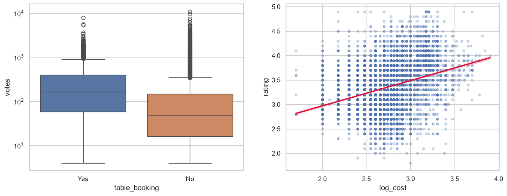
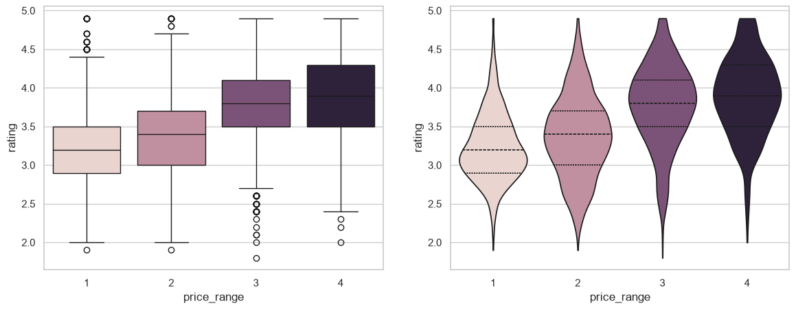

# Zomato Restaurant Analysis: What Drives Ratings and Customer Engagement?


> Python + SQLite analysis of what drives Zomato restaurant ratings and votes: table booking, online delivery, price range, vote outliers and hidden gems.

**TL;DR:** Table booking looks like it boosts ratings (3.59 vs 3.41), but it's a price-range effect. Within the same price range, booking restaurants actually rate lower. Delivery has almost no effect on ratings. Price range and votes are the real signals.

---

## Table of Contents
1. [Business Question](#business-question)
2. [Key Findings](#key-findings)
3. [Recommendations](#recommendations)
4. [About the Dataset](#about-the-dataset)
5. [Data Cleaning](#data-cleaning)
6. [KPIs and Metrics](#kpis-and-metrics)
7. [Approach](#approach)
8. [Tools and Requirements](#tools-and-requirements)
9. [Repository Structure](#repository-structure)
10. [How to Run](#how-to-run)
11. [Limitations](#limitations)
12. [Author](#author)

---

## Business Question

Which restaurant attributes (table booking, online delivery, price range) are associated with higher ratings and more customer votes, and which highly rated restaurants are still under-discovered?

This matters to two audiences:
- **Restaurant owners:** which service features and pricing choices go with better customer perception.
- **Platform teams (e.g. Zomato):** which high-quality restaurants deserve more visibility.

---

## Key Findings

**Scope:** 9,550 restaurants in the dataset. 2,148 were unrated (rating = 0) and excluded, leaving **7,402** for analysis.

### 1. Table booking looks beneficial, but isn't
Restaurants with booking average **3.59 vs 3.41** without, and get about 3x the median votes (**165 vs 49**). But booking is concentrated in expensive restaurants (about 45% of price ranges 3 and 4, almost none in range 1). Within the same price range, booking restaurants rate **lower**: 3.62 vs 3.91 in range 3, and 3.70 vs 4.05 in range 4. After controlling for price range, booking is associated with about **-0.21 rating points**.



### 2. Online delivery has essentially no effect on ratings
Delivery restaurants average **3.38 vs 3.47** without. After controlling for price range, the gap shrinks to about **-0.04 points**, and the correlation is near zero. Delivery does go with somewhat higher vote counts (median **84 vs 47**).

### 3. Higher price range goes with higher ratings, with diminishing returns
Average rating rises from **3.24** (range 1) to **3.38**, **3.78** and **3.89** (range 4). Spearman correlation is **0.40**. For India alone, cost vs rating gives Spearman **0.33**. The jump from range 3 to 4 is only about 0.1.



### 4. Votes and ratings are strongly linked
Spearman correlation is **0.68**, the strongest relationship in the data. Votes are heavily skewed: median **60**, mean **202**, with **838** restaurants above the outlier fence of 424 votes. Ratings from very few voters are also less reliable.

### 5. Hidden gems
**109** restaurants are rated **4.0 or higher with 60 or fewer votes** (the median). New Delhi has the most (**30**), followed by Rio de Janeiro (**19**).

---

## Recommendations

- **For restaurants:** Don't assume table booking improves ratings. Compare against restaurants in the same price range before drawing conclusions.
- **For the platform:** Surface the 109 hidden-gem restaurants to increase their discoverability, and show vote counts alongside ratings so users can judge how reliable a score is.
- **For analysts:** Use medians for votes, since the distribution is heavily skewed, and control for price range when comparing features.

---

## About the Dataset

| Item | Detail |
|---|---|
| **Name** | Restaurant Market Analysis: Ratings, Prices |
| **Source** | [Kaggle: srisyra02/zomato-market-analysis](https://www.kaggle.com/datasets/srisyra02/zomato-market-analysis) |
| **Description** | Restaurant ratings, cuisines and pricing data from Zomato |
| **File used** | `Zomato_Restaurant_Dataset.xlsx` (in `data/`) |
| **Rows** | 9,550 (7,402 after excluding unrated restaurants) |
| **Geography** | About 90% India, with restaurants in other countries |

### Key fields used
> Update this table to match your exact column names.

| Field | Description |
|---|---|
| Restaurant name | Name of the restaurant |
| City / Country code | Location of the restaurant |
| Cuisines | Cuisine types served |
| Rating | Aggregate customer rating (0 = not rated) |
| Votes | Number of customer votes |
| Price range | Price tier from 1 (lowest) to 4 (highest) |
| Average cost | Approximate cost, in local currency |
| Has table booking | Whether table booking is available |
| Has online delivery | Whether online delivery is available |
| Currency | Local currency of the cost column |

---

## Data Cleaning

- Excluded **2,148 unrated restaurants** (rating 0 means "Not rated", not a bad rating).
- Fixed **3 corrupted city names** (São Paulo, Brasília, İstanbul) using country codes.
- Rebuilt the currency column from country codes (e.g. Philippines was labelled "Botswana Pula").
- Excluded zero-cost rows from cost analysis. Cost was analysed for **India only**, since costs are in 12 currencies.
- Some restaurant names remain garbled in the source file and can't be recovered.

---

## KPIs and Metrics

| KPI | Definition |
|---|---|
| **Average rating** | Mean rating overall and by segment (booking, delivery, price range) |
| **Median votes** | Median votes per restaurant, used instead of the mean because of skew |
| **Rating gap (booking / delivery)** | Difference in average rating between restaurants with and without the feature, raw and within price range |
| **Rating by price range** | Average rating for each price range (1 to 4) |
| **Spearman correlation** | Rating vs price range, rating vs cost (India), rating vs votes |
| **Vote outliers** | Restaurants above the upper outlier fence (424 votes) |
| **Hidden gems** | Rating ≥ 4.0 and votes ≤ median (60) |

---

## Approach

1. **Data cleaning** in pandas: exclusions, text fixes, currency rebuild
2. **Exploratory analysis:** distributions, missing values, outliers
3. **SQL analysis in SQLite:** aggregation and segmentation queries
4. **Controlling for confounders:** comparing booking and delivery within each price range
5. **Visualisation:** seaborn boxplots, violin plots, correlation heatmaps
6. **Insight synthesis:** findings and recommendations

---

## Tools and Requirements

- **Language:** Python 3.10+
- **Libraries:** pandas, numpy, matplotlib, seaborn, scipy, openpyxl, jupyter
- **Database:** SQLite

```bash
pip install -r requirements.txt
```


---

## Conclusions

1. Table booking and delivery look related to ratings and votes overall, but the booking-rating link disappears once price range is controlled for.
2. Higher price range is moderately associated with higher ratings.
3. Higher-rated restaurants get many more votes, and a small group of restaurants dominates total votes.
4. Hidden gems exist across cities, concentrated in the largest ones.


---

## Limitations

- **Correlation is not causation:** pricier restaurants may attract different reviewers.
- **Hidden gems are candidates, not proven winners.** A 4.9 from 30 voters is a noisy estimate.
- **The dataset is about 90% India**, so global conclusions lean on Indian restaurants.

---

## Author

**Aagam Jain**


[LinkedIn](https://www.linkedin.com/in/aagamjain23164071/) · [GitHub](https://github.com/jainaagam1) · [Email](jainaagam777@gmail.com)
